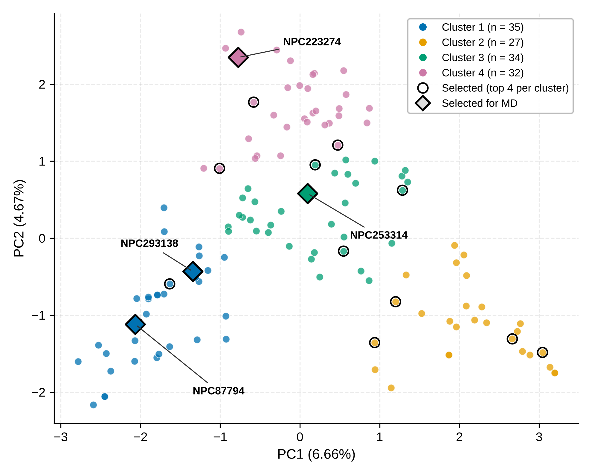

# FabI Natural Product Virtual Screening

Structure-based virtual screening of NPASS natural products against FabI (enoyl-ACP reductase, PDB: 6AHE) from *Acinetobacter baumannii*, a validated antibacterial target in fatty acid biosynthesis.

**Status:** research code accompanying a manuscript in preparation. All results are computational and have not been tested experimentally.

## Pipeline

RDKit filtering → 3D structure generation → PDBQT conversion → AutoDock Vina docking → PCA/KMeans clustering → ligand efficiency filtering → interaction analysis → 100 ns molecular dynamics (GROMACS)

| Step | Method | Compounds left |
|------|--------|----------------|
| 0 | NPASS library (2023 update) | ~94,400 |
| 1 | RDKit filtering: invalid/duplicate removal, Lipinski (0 violations), PAINS, rotatable bonds < 10, predicted ADMET | 369 |
| 2 | AutoDock Vina docking, score <= -8.0 kcal/mol | 128 |
| 3 | PCA + KMeans (k = 4), top 4 per cluster | 16 |
| 4 | Ligand efficiency >= 0.35 kcal/mol per heavy atom | 12 |
| 5 | Complex preparation (failed for 2 compounds) and 2D interaction analysis | 10 → 4 |
| 6 | 100 ns molecular dynamics (GROMACS) | 2 stable |

## Target and docking

- Receptor: PDB 6AHE (A. baumannii FabI with NAD and AFN-1252, 2.29 Å), chain A with the NAD cofactor kept.
- Docking validation: redocking of AFN-1252 gave a score of -10.8 kcal/mol and a heavy-atom RMSD of 1.73 Å (below the 2.0 Å threshold).
- AutoDock Vina: grid centre (-37.508, -7.028, -3.125), size 26 x 26 x 30 Å, exhaustiveness 32.
- Ligand preparation: ETKDGv3 conformers (RDKit), MMFF94 minimization, Open Babel PDBQT conversion with Gasteiger charges.

## Repository structure

- `protein/` - prepared receptor (PDBQT)
- `notebooks/` - RDKit filtering and post-docking analysis
- `docking/` - Vina docking scores
- `data/` - selected candidate compounds
- `figures/` - PCA and clustering plots
- `interaction_analysis/` - 2D interaction diagrams
- `md/` - GROMACS input files and analysis scripts
- `docs/` - short methodology write-up

## Results

### Chemical space (PCA)

### Cluster selection (KMeans elbow and silhouette)

### Compounds selected for MD

| Compound | Cluster | Vina score (kcal/mol) | Heavy atoms | LE |
|----------|---------|-----------------------|-------------|-----|
| NPC253314 | 3 | -11.1 | 31 | 0.358 |
| NPC223274 | 4 | -10.4 | 23 | 0.452 |
| NPC87794 | 1 | -10.0 | 22 | 0.455 |
| NPC293138 | 1 | -9.3 | 20 | 0.465 |

Reference: redocked AFN-1252 scored -10.8 kcal/mol.

### Molecular dynamics (100 ns, mean ± SD)

| System | Ligand RMSD (nm) | Last 20 ns (nm) | H-bonds (frames with >= 1) |
|--------|------------------|-----------------|----------------------------|
| NPC87794 | 0.275 ± 0.048 | 0.256 ± 0.053 | 1.28 (90.4%) |
| NPC253314 | 0.361 ± 0.041 | 0.392 ± 0.030 | 0.85 (68.9%) |
| NPC223274 | 0.471 ± 0.204 | 0.704 ± 0.081 | 0.55 (48.6%) |
| NPC293138 | 0.686 ± 0.243 | 0.958 ± 0.149 | 1.36 (83.5%) |
| Control (AFN-1252) | 0.326 ± 0.076 | 0.384 ± 0.046 | 1.31 (78.6%) |

NPC87794 and NPC253314 stayed bound for the full 100 ns. NPC223274 left its docked pose after about 40 ns, and NPC293138 drifted continuously.

## MD setup

GROMACS 2023.3, CHARMM36 force field, CGenFF ligand topologies, TIP3P water, NADH cofactor. NVT 1 ns (300 K), NPT 100 ps (1 bar), production run 100 ns, 2 fs time step, V-rescale thermostat, Parrinello-Rahman barostat, PME electrostatics, LINCS constraints. One run per system.

## Requirements

See `requirements.txt` (Python packages: RDKit, scikit-learn, pandas, NumPy, Matplotlib). AutoDock Vina, Open Babel, UCSF Chimera, Discovery Studio Visualizer and GROMACS must be installed separately.

## Methodology

See `docs/workflow_methodology.md`.

## Limitations

- Docking scores rank compounds but are not measured affinities, and the protocol was validated only by redocking (no decoy enrichment test).
- ADMET filters use predictions.
- Each MD system was simulated once; replicate runs are needed.
- Binding free energies were not calculated.
- NPC87794 is a small molecule, so part of its low RMSD may reflect its size.
- All compounds are computational hits and have not been tested in the laboratory.

## Data availability

- Crystal structure: Protein Data Bank, accession 6AHE.
- Natural product library: NPASS database.

## License

MIT, see `LICENSE`.

## Author

Mateen Ahmad (abmateen612).
