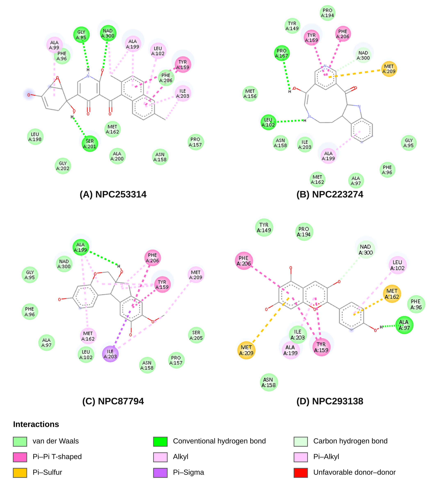

# Structure-Based Discovery of Natural Product Candidates Targeting FabI in *Acinetobacter baumannii*

## Overview

This repository contains the computational workflow and results of a structure-based virtual screening study to identify potential natural product candidates targeting FabI, an essential enzyme involved in bacterial fatty acid biosynthesis in *Acinetobacter baumannii*.

Approximately 94,400 natural products from the NPASS database were screened using cheminformatics-based filtering, molecular docking, chemical space analysis, protein–ligand interaction analysis, and molecular dynamics (MD) simulations.

The study identified four candidates for MD simulations, with two showing comparatively stable binding poses during the 100 ns simulations.

## Objectives

- Identify potential FabI-targeting natural product candidates from the NPASS database.
- Apply physicochemical, structural, and predicted ADMET-based filters to prioritize compounds.
- Evaluate ligand binding using molecular docking and validate the docking protocol through redocking.
- Explore chemical diversity using PCA and K-means clustering.
- Compare protein–ligand interaction profiles and select candidates for MD simulations.
- Investigate the dynamic stability of selected protein–ligand complexes.

## Computational Workflow

| Screening stage | Compounds |
|---|---:|
| Initial NPASS library | ~94,400 |
| After drug-likeness and ADMET filtering | 369 |
| Docking score ≤ −8.0 kcal/mol | 128 |
| Top four compounds from each cluster | 16 |
| After ligand efficiency filtering | 12 |
| Successfully prepared and analyzed complexes | 10 |
| Selected for molecular dynamics | 4 |
| Comparatively stable candidates during MD | 2 |

## Target Selection and Molecular Docking

The crystal structure of *A. baumannii* FabI (PDB ID: **6AHE**) was retrieved from the Protein Data Bank and prepared for molecular docking.

AutoDock Vina was used for docking the filtered natural products. The docking protocol was validated by redocking the native ligand AFN-1252 into its binding site.

### Docking Validation

| Parameter | Result |
|---|---:|
| Protein structure | PDB: 6AHE |
| Reference ligand | AFN-1252 |
| Redocking RMSD | 1.73 Å |
| Reference ligand docking score | −10.8 kcal/mol |
| Vina exhaustiveness | 32 |
| Grid dimensions | 26 × 26 × 30 Å |
| Grid center | −37.508, −7.028, −3.125 |

The redocking RMSD of 1.73 Å supports the ability of the docking protocol to reproduce the reference ligand binding pose.

## Cheminformatics and Compound Filtering

The NPASS library was processed using RDKit to remove invalid structures and duplicate compounds. The remaining compounds were subjected to sequential filtering based on:

- Lipinski's Rule of Five, retaining compounds with zero violations.
- PAINS structural alerts.
- Rotatable bond count below 10.
- Predicted ADMET properties using ADMET-AI.

Following these filtering steps, 369 compounds were retained for molecular docking.

Ligand structures were generated using ETKDGv3, energy-minimized using MMFF94, and prepared for docking using Open Babel and Gasteiger partial charges.

## Molecular Docking and Candidate Selection

Molecular docking was performed using AutoDock Vina. A total of 128 compounds with docking scores of ≤ −8.0 kcal/mol were retained for further analysis.

Ligand efficiency was estimated to account for differences in molecular size. The compounds were subsequently prioritized using chemical space analysis and clustering.

### Chemical Space Analysis

Morgan fingerprints were generated using a radius of 2 and 1024 bits. Principal Component Analysis (PCA) was applied to explore the chemical space of the docked compounds.

The first two principal components explained 6.66% and 4.67% of the variance, respectively, accounting for a combined 11.33%.


### K-means Clustering

K-means clustering was performed using the first two PCA components. The number of clusters was selected using the elbow method and silhouette analysis.

Four clusters were obtained, with a silhouette score of approximately 0.504.


The top four docking candidates from each cluster were selected, resulting in 16 compounds. Following ligand efficiency filtering, 12 compounds were retained. Two complexes could not be prepared successfully, leaving 10 compounds for protein–ligand interaction analysis.

## Selected Compounds

Four compounds were selected for subsequent molecular dynamics simulations based on docking scores, ligand efficiency, chemical diversity, and interaction analysis.

| NPASS ID | Cluster | Vina Score (kcal/mol) | Heavy Atoms | Ligand Efficiency |
|---|---:|---:|---:|---:|
| NPC253314 | 3 | −11.1 | 31 | 0.358 |
| NPC223274 | 4 | −10.4 | 23 | 0.452 |
| NPC87794 | 1 | −10.0 | 22 | 0.455 |
| NPC293138 | 1 | −9.3 | 20 | 0.465 |

## Protein–Ligand Interaction Analysis

Protein–ligand interaction diagrams were generated using **Discovery Studio Visualizer 2025**. Each diagram represents one compound and is named according to its NPASS compound ID.

The analysis was performed on docked complexes involving FabI (PDB: 6AHE), with the NAD cofactor retained.

The diagrams illustrate:

- Hydrogen bonds
- Hydrophobic interactions
- Other protein–ligand contacts
- Interacting amino acid residues
- Interaction distances

These interaction profiles were compared to support the selection of four compounds for subsequent molecular dynamics simulations.



## Molecular Dynamics Simulations

Molecular dynamics simulations were performed for the four selected protein–ligand complexes and the reference ligand AFN-1252 using GROMACS 2023.3.

### Simulation Setup

| Parameter | Details |
|---|---|
| Software | GROMACS 2023.3 |
| Force field | CHARMM36 |
| Water model | TIP3P |
| Ligand parameters | CGenFF |
| Simulation duration | 100 ns |
| Time step | 2 fs |
| Thermostat | V-rescale |
| Barostat | Parrinello–Rahman |
| Electrostatics | Particle Mesh Ewald (PME) |
| Bond constraints | LINCS |
| NVT equilibration | 1 ns |
| NPT equilibration | 100 ps |

NADH was retained as the enzyme cofactor during MD simulations. Each system was simulated once.

### Molecular Dynamics Results

Ligand RMSD and hydrogen-bond analysis were used to investigate the stability of the protein–ligand complexes.

| Compound | Mean Ligand RMSD (nm) | Last 20 ns RMSD (nm) | Mean H-bonds | Frames with ≥1 H-bond |
|---|---:|---:|---:|---:|
| NPC87794 | 0.275 ± 0.048 | 0.256 ± 0.053 | 1.28 | 90.4% |
| NPC253314 | 0.361 ± 0.041 | 0.392 ± 0.030 | 0.85 | 68.9% |
| NPC223274 | 0.471 ± 0.204 | 0.704 ± 0.081 | 0.55 | 48.6% |
| NPC293138 | 0.686 ± 0.243 | 0.958 ± 0.149 | 1.36 | 83.5% |
| AFN-1252 | 0.326 ± 0.076 | 0.384 ± 0.046 | 1.31 | 78.6% |

### MD Interpretation

NPC87794 maintained a comparatively stable ligand pose throughout the simulation, with a mean ligand RMSD of 0.275 nm and consistent hydrogen-bond interactions.

NPC253314 also showed comparatively stable behavior, although its ligand RMSD increased slightly during the final 20 ns.

NPC223274 exhibited a substantial increase in ligand RMSD after approximately 40 ns, while NPC293138 showed considerable ligand displacement from its initial binding pose.

Among the four candidates, NPC87794 and NPC253314 demonstrated comparatively favorable dynamic stability. These findings support their prioritization for further investigation but do not establish inhibitory activity.

## Repository Structure

```text
acinetobacter-fabi-natural-product-discovery/
│
├── protein/
│   └── FabI structure and preparation files
│
├── notebooks/
│   └── Computational analysis notebooks
│
├── docking/
│   └── Molecular docking files and results
│
├── data/
│   └── Compound datasets and screening results
│
├── figures/
│   ├── pca_clusters.png
│   └── Kmeans_Elbow_Silhouette.png
│
├── interaction_analysis/
│   └── Protein–ligand interaction diagrams
│
├── md/
│   └── Molecular dynamics simulation files and analyses
│
├── docs/
│   └── Additional methodology and documentation
│
├── requirements.txt
├── workflow_methodology.md
└── README.md
```

## Software and Tools

The computational workflow used the following tools:

- **Python** – Computational analysis and data processing
- **RDKit** – Molecular structure processing, filtering, and fingerprint generation
- **ADMET-AI** – Predicted ADMET property assessment
- **AutoDock Vina** – Molecular docking
- **Open Babel** – Molecular structure conversion and preparation
- **PCA and scikit-learn** – Dimensionality reduction and clustering
- **Discovery Studio Visualizer 2025** – Protein–ligand interaction analysis
- **GROMACS 2023.3** – Molecular dynamics simulations
- **CGenFF** – Ligand force-field parameter generation

## Installation

Clone the repository:

```bash
git clone https://github.com/abmateen612/acinetobacter-fabi-natural-product-discovery.git
cd acinetobacter-fabi-natural-product-discovery
```

Install the Python dependencies:

```bash
pip install -r requirements.txt
```

Additional software, including AutoDock Vina, Open Babel, Discovery Studio Visualizer, and GROMACS, should be installed separately according to their respective documentation.

## Limitations

- The findings are based entirely on computational predictions and require experimental validation.
- Molecular docking scores provide estimates and do not directly establish binding affinity or inhibitory activity.
- Docking validation was based on native ligand redocking; decoy-based enrichment analysis was not performed.
- ADMET properties were computationally predicted and have not been experimentally confirmed.
- Gram-negative bacterial permeability and efflux effects were not experimentally investigated.
- Each molecular dynamics system was simulated once.
- Binding free energy calculations were not performed.

## Data Availability

The computational workflow, analysis scripts, and available results are organized within this repository. Additional datasets and simulation files are provided in their respective directories where available.

## License

This project is distributed under the MIT License.

## Author

**Mateen Ahmad**  
MS Biotechnology  
COMSATS University Islamabad, Abbottabad Campus, Pakistan

- GitHub: https://github.com/abmateen612
- Repository: https://github.com/abmateen612/acinetobacter-fabi-natural-product-discovery
